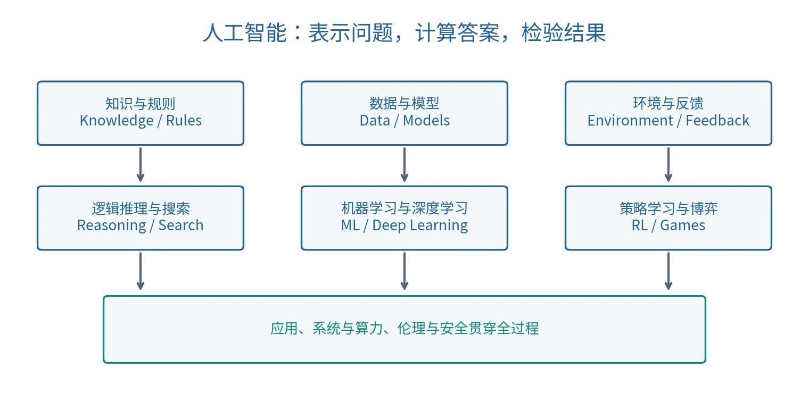

# 人工智能的框架与发展

## 人工智能研究什么

人工智能（Artificial Intelligence，AI）研究以计算方法实现感知、知识表示、推理、学习、规划与决策。判断一个系统是否完成某项智能任务，应明确输入、输出、任务目标、评价标准与适用环境；完成一种任务不等于具备所有类型的智能。

1955 年的达特茅斯研究计划由 John McCarthy、Marvin Minsky、Nathaniel Rochester、Claude Shannon 提出；1956 年的研讨会通常作为 AI 学科形成的标志。计划的核心设想是：如果能够足够精确地描述学习和智能的某些方面，就可能让机器模拟它们。这是研究纲领，不是已经证明的一般智能定理。[原始研究计划](https://www-formal.stanford.edu/jmc/history/dartmouth/dartmouth.html)

计划涉及自动计算机、语言、神经网络、计算规模、自我改进、抽象，以及随机性与创造性。今天的系统仍面对其中许多问题：如何表示世界、怎样控制计算成本、怎样学习可迁移的规律。

## 三种研究传统

| 传统 | 英文 | 主要思想 | 常见方法与局限 |
| --- | --- | --- | --- |
| 符号主义 | Symbolism | 用符号、事实与规则显式表达知识 | 逻辑推理、专家系统；知识获取与维护成本较高 |
| 连接主义 | Connectionism | 用大量连接及其参数学习表示和映射 | 神经网络、深度学习；依赖数据、优化与计算资源 |
| 行为主义 | Behaviorism | 在环境交互中研究行为与适应 | 智能体、反馈控制、强化学习；奖励设计和探索很关键 |

这些传统可以组合。例如，用神经网络识别图像对象，再把识别结果交给规则系统检查约束；也可以把符号知识用于限制学习系统的动作。

## 五类基础方法

*原创示意图，见 [图示说明](assets/README.md)。*

### 逻辑推理（Logical Reasoning）

把已有事实和规则形式化，并通过有效推理规则得到结论。若前提为真且推理有效，结论必须为真。它适合表达明确约束、可解释规则与知识关系；面对噪声和不完整知识时，需要概率或其他扩展。

### 搜索（Search）

把问题建模为状态、动作和目标，探索可能的行动序列。例如路径规划、拼图与棋类决策。关键挑战是候选空间迅速增长；启发式（Heuristic）利用领域信息引导探索。

### 机器学习（Machine Learning，ML）

从数据中学习模型或规律，而不必人工枚举每条输入输出规则。监督学习（Supervised Learning）使用带标签样本：

$$
\mathcal D=\{(x_i,y_i)\}_{i=1}^{n},\qquad \hat y=f_\theta(x).
$$

训练通过损失函数（Loss Function）调整参数 $\theta$，测试则评价未参与训练的数据上的泛化能力（Generalization）。拟合训练集不代表掌握真实规律，也不代表面对分布变化仍可靠。

图像可以表示为数值数组：灰度图常用 $H\times W$，RGB 彩色图常用 $H\times W\times3$。分类器从数组提取或学习特征（Feature），预测类别。数值表示是计算的起点，不等于已经理解图像的语义。

深度学习（Deep Learning，DL）利用多层可学习变换获得层次表示，是机器学习的重要分支：

$$
\mathrm{DL}\subseteq\mathrm{ML}\subseteq\mathrm{AI}.
$$

### 强化学习（Reinforcement Learning，RL）

智能体（Agent）观察状态 $s_t$，选择动作 $a_t$，环境返回奖励 $r_{t+1}$ 与下一状态 $s_{t+1}$。目标通常是最大化期望累积回报：

$$
\mathbb E\!\left[\sum_{t=0}^{T-1}\gamma^t r_{t+1}\right],\qquad 0\leq\gamma\leq1.
$$

策略（Policy）规定在某状态下怎样选择动作。探索（Exploration）尝试不确定的动作，利用（Exploitation）选择目前已知较好的动作；两者需要平衡。延迟奖励还带来信用分配（Credit Assignment）问题：最终成功应归功于哪些早期动作？

强化学习的经验来自交互，也可能使用离线轨迹；它同样需要数据。奖励是学习信号，设计错误的奖励可能导致偏离真实目标的行为。

### 博弈（Game Theory / Game Playing）

当结果取决于多个参与者的策略时，需要考虑他人的响应。纳什均衡（Nash Equilibrium）表示其他人策略固定时，任一参与者单方面改变自己的策略都不能提高收益；它不保证社会总收益最大，也不表示所有人都满意。棋类对抗搜索是博弈的一种计算场景，不能据此把所有博弈视为零和博弈（Zero-sum Game）。

## 从历史理解方法的条件

| 阶段 | 主要进展 | 推动或限制因素 |
| --- | --- | --- |
| 1950—1960 年代 | AI 学科形成，早期符号推理和问题求解 | 小规模演示展示能力，但任务规模扩大后计算困难 |
| 1970 年代 | 对早期承诺重新评估，出现低潮 | 组合爆炸、资源限制与现实环境复杂性 |
| 1980 年代 | 专家系统（Expert System）广泛研究和应用 | 显式知识有效，但知识获取、更新、维护和迁移成本高 |
| 1980 年代末至 1990 年代 | 商业与技术受限，再次调整方向 | 狭窄领域成功难以直接推广到开放环境 |
| 2010 年代以来 | 深度学习快速发展，2012 年图像识别成果成为重要节点 | 数据、GPU 算力、模型结构和训练方法协同进步 |

“AI 寒冬”（AI Winter）反映技术能力、社会预期与投入之间的不匹配。某个阶段的方法遇到限制，并不表示该方法的全部思想失效。符号方法、统计学习与神经网络在现代系统中仍可并存。

## 图灵测试与能力评价

图灵测试（Turing Test）用对话中的行为表现讨论机器智能：评判者通过交流尝试区分人和机器。它把评价转向可观察行为，但不能仅凭对话难以区分就证明意识、因果理解或所有任务的泛化能力。不同智能任务仍需要专门的测试与失败分析。

## 从方法到完整系统

课程知识体系可按十个相互关联的主题理解：发展历史、知识表达与推理、搜索求解、机器学习、深度学习、强化学习、博弈、伦理与安全、架构与系统、应用。前七项主要解释计算方法，后三项连接系统实现与实际使用；边界并非互斥。

完整的 AI 系统不仅包含一个预测模型，还包含数据处理、知识表示、训练与推理计算、交互机制、评价、伦理与安全约束。课程后续的机器学习、深度学习、强化学习与博弈建立在当前的表示、推理与搜索基础上。

AI+X 指把 AI 方法应用于某领域；X+AI 强调领域知识也能反过来改进 AI，例如用物理约束限制预测空间。领域问题的定义、数据质量与评价设计往往比单纯增加样本数量更关键。

将 AI 称为通用目的技术（General-purpose Technology）时，强调的是它可以影响许多行业；这里的缩写 GPT 与生成式预训练变换器（Generative Pre-trained Transformer）的同名缩写语义不同。

## 开放环境对显式规则的挑战

规范化知识（Formalized Knowledge）把概念、属性和关系写成可操作的表示，使规则能够被检查与计算。但仅依靠预先列举规则，在开放环境中容易遇到两个问题：

- 先决条件问题（Qualification Problem）：难以列举一个动作成功所需的所有前提。例如“启动汽车”不仅需要有油和电，还可能受部件损坏、温度等条件影响。
- 隐性分支／连带后果问题（Ramification Problem）：难以列举一个动作引发的所有间接后果。例如移动一个承载物，也会改变其上其他物体的位置。

这些问题涉及知识建模与动态变化，不等同于程序代码中的分支语句。数据驱动方法减少了某些手工枚举需求，也带来数据偏差、分布变化和解释困难；组合方法仍需要明确假设与评价。

通用人工智能（Artificial General Intelligence，AGI）关注跨任务学习、适应与迁移等广泛能力。单一任务的高分不能直接证明这种广泛能力；定义和评价标准应随具体讨论明确。

## 认识能力与使用边界

AI 可辅助文献整理、建模、模拟、模式发现和实验设计，但科学结论仍需要理论一致性、独立数据或实验检验。拟合八个行星的数据可以得到许多函数；开普勒第三定律的核心关系是轨道周期平方与半长轴立方成正比：$T^2\propto a^3$。低训练误差本身不能证明模型发现了自然规律。

人工智能素养（AI Literacy）包括理解基本概念、选择和评价工具、核验输出，以及认识公平性、隐私、安全与责任问题。生成模型的流畅回答可能包含幻觉（Hallucination）；应检查事实依据、推导过程和适用条件。涉及创造力或通用智能的观点需要具体定义与证据，不能从单个演示直接推出普遍能力。

理解本课的关键问题是：系统利用了什么知识、怎样获得数据、优化了什么目标、结果为何可信、失败会在哪里发生。

## 继续阅读

[可计算性与形式系统](02-computability.md)解释计算的理论边界；[命题逻辑](03-propositional-logic.md)给出严格推理的第一种语言。

课程来源与公式校订见 [资料对照与校订依据](source-map.md)。
