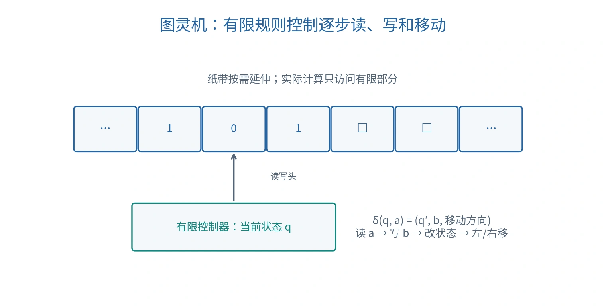

# 可计算性与形式系统

## 计算之前先定义问题

计算问题（Computational Problem）需要明确输入、合法输出与两者的关系。算法（Algorithm）必须具有有限描述，其步骤可机械执行。讨论问题是否可计算，应覆盖所有合法输入，而不是只观察一次运行是否成功。

| 概念 | 英文 | 所问的问题 |
| --- | --- | --- |
| 可计算性 | Computability | 是否存在满足要求的算法？ |
| 可判定性 | Decidability | 是否存在对每个输入都停机并回答是／否的算法？ |
| 计算复杂性 | Computational Complexity | 存在算法时，需要多少时间与空间？ |

“目前算不出”“某个程序运行很久”“问题没有解”都不能单独证明问题不可计算。

## 图灵机：计算的形式模型

图灵机（Turing Machine）由纸带、读写头和有限控制器构成。纸带保存符号，读写头每步访问一个位置；控制器根据当前状态和读到的符号选择下一步：

$$
\delta(q,a)=(q',b,D),\qquad D\in\{L,R\}.
$$

含义是：在状态 $q$ 读到 $a$，写入 $b$，进入 $q'$，再向左或向右移动。停机状态表示计算结束；具体模型也可以允许原地停留，不改变可计算能力。

*原创原理图，纸带两侧可按需延伸。*

图灵机不是某一台实际计算机的硬件设计，而是分析计算能力的抽象模型。课堂算式

$$
\gcd(24,16)\times10+17=8\times10+17=97
$$

展示的是可以分解成机械步骤的过程；求最大公约数、乘法和加法都可以进一步展开，不能把整项运算视作一个图灵机基本转移。

丘奇—图灵论题（Church–Turing Thesis）主张：直观意义下有效可执行的计算过程，都可以由图灵机实现。它连接非形式化的“有效计算”与形式模型，因而不是普通数学定理。图灵可计算、$\lambda$ 演算可计算与一般递归／部分递归函数给出等价的计算能力。

原始递归函数（Primitive Recursive Function）是较小的类别，不能与全部递归可计算函数等同；Ackermann 函数是可计算但非原始递归的经典例子。

## 可判定、可识别与停机问题

可识别（Recognizable / Semidecidable）的问题存在这样的程序：对“是”的输入最终接受，对“否”的输入可以拒绝，也可能永不停机。可判定则要求所有输入都在有限时间内给出正确答案。

停机问题（Halting Problem）问：给定程序 $P$ 和输入 $x$，$P(x)$ 是否最终停机？不存在解决所有程序与输入的通用判定算法。

反证的核心是自指。假设判定器 $H(P,x)$ 总能正确返回停机与否，构造程序 $D(P)$：如果 $H(P,P)$ 判定停机，就无限循环；否则立即停机。现在分析 $D(D)$：

- 若 $H(D,D)$ 回答“停机”，$D(D)$ 按定义无限循环。
- 若回答“不停机”，$D(D)$ 按定义立即停机。

两种情况都矛盾，因此这样的通用 $H$ 不存在。这不意味着所有具体程序的停机性都无法分析。

### “无解”不是“不可计算”

费马大定理说，对整数 $n>2$，方程 $a^n+b^n=c^n$ 没有正整数解。对给定的 $(a,b,c,n)$，检查等式是可计算的；对该特定存在性问题，可以依据定理回答“没有”。朴素枚举在找不到解时不停止，只能说明这种程序不是一个完整判定器，不能据此认定该问题不可计算。

## 形式系统中的三个概念

形式系统（Formal System）由语言、公理和推理规则组成。设 $T$ 是某个理论，$\varphi$ 是一个句子。

| 概念 | 定义 | 注意 |
| --- | --- | --- |
| 一致性（Consistency） | 不会同时有 $T\vdash\varphi$ 与 $T\vdash\neg\varphi$ | 关注理论是否导出矛盾 |
| 理论的句法完全性（Syntactic Completeness） | 对每个句子 $\varphi$，$T\vdash\varphi$ 或 $T\vdash\neg\varphi$ | 关注该理论能否决定每个句子 |
| 推理系统的语义完备性（Semantic Completeness） | 若 $\Gamma\models\varphi$，则 $\Gamma\vdash\varphi$ | 关注所有逻辑后果能否由规则证明 |

$\vdash$ 表示“可证明”，$\models$ 表示“语义蕴涵”。可靠性（Soundness）是反向保证：若可证明，则确实是逻辑后果。

一阶逻辑拥有可靠且语义完备的证明系统，但这不意味着每个特定的一阶理论都是句法完全的，也不意味着一般的一阶有效性存在总会停机的判定算法。

## 哥德尔不完全性定理的条件

第一不完全性定理（First Incompleteness Theorem）适用于有效公理化、一致、并且足够表达算术的理论：存在它无法证明也无法反驳的句子。第二不完全性定理在相应形式化条件下指出，这样的理论不能在自身内部证明自身的一致性。

条件不能省略。它们并不是“任何知识系统都不完整”的口号，也不直接判定自然语言论述或机器学习模型的能力。希尔伯特关于算术一致性的计划，与一般逻辑的判定问题（Entscheidungsproblem）有联系，但不是同一个问题。

## 与 AI 的联系

命题逻辑的可满足性问题（Satisfiability，SAT）是可判定的：有限变量可枚举真值赋值；它同时是 NP 完全问题（NP-complete）。是否存在一般多项式时间算法仍涉及未解决的 $P$ 与 $NP$ 问题，不能写成已证明不可能。

一般一阶逻辑有效性可通过证明搜索半判定，但不存在通用的完整判定算法。实际 AI 系统因此常限制语言、限制搜索资源，或采用近似推理。

计算理论讨论“原则上是否可解”；搜索复杂性讨论“用多少资源找到解”。两种限制都影响 AI，却需要不同证据。

课程来源与公式校订见 [资料对照与校订依据](source-map.md)。
