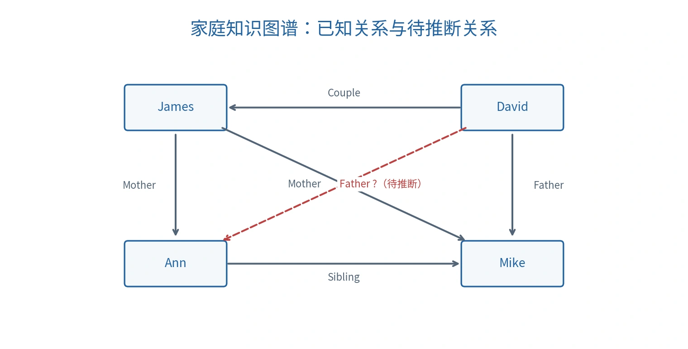
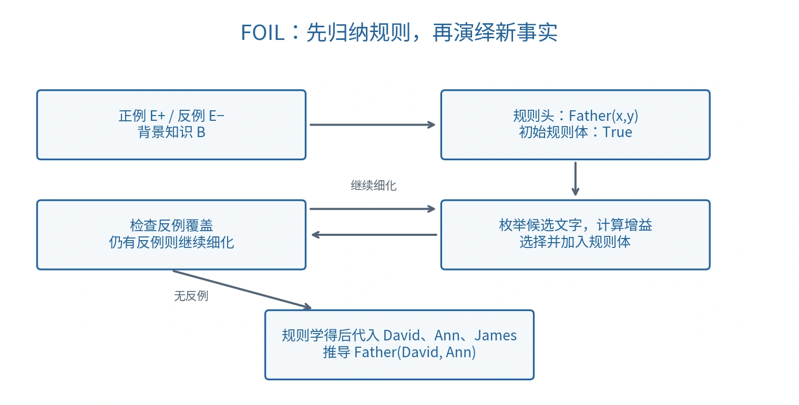

# 知识图谱、FOIL 与路径推理

## 知识图谱的表示

知识图谱（Knowledge Graph，KG）将知识表示为实体（Entity）与关系（Relation）。一个事实常写成三元组（Triple）：

$$
(h,r,t),\qquad\text{或}\qquad r(h,t),
$$

其中 $h$ 是头实体，$t$ 是尾实体，$r$ 是关系。边的方向由关系的参数语义决定，不代表重要性、支配关系或时间先后。

课堂家庭图包含：

$$
\begin{aligned}
&\mathrm{Couple}(\mathrm{David},\mathrm{James}),\\
&\mathrm{Mother}(\mathrm{James},\mathrm{Ann}),\quad
\mathrm{Mother}(\mathrm{James},\mathrm{Mike}),\\
&\mathrm{Sibling}(\mathrm{Ann},\mathrm{Mike}),\quad
\mathrm{Father}(\mathrm{David},\mathrm{Mike}).
\end{aligned}
$$

*保留课件实体命名的原创重绘；红色虚线是查询，不是已知事实。*

待补全关系是 $\mathrm{Father}(\mathrm{David},\mathrm{Ann})$。若采用规则

$$
\mathrm{Couple}(x,z)\land\mathrm{Mother}(z,y)\to\mathrm{Father}(x,y),
$$

代入 $x=\mathrm{David},z=\mathrm{James},y=\mathrm{Ann}$ 即可推出查询。

这里的规则是课堂简化家庭模型的假设；在现实中，配偶关系并不足以保证亲子关系，实际系统还需要时间、身份与亲子事实等约束。

## 已知事实、演绎结论与预测

演绎（Deduction）从给定事实和规则推出结论；归纳（Induction）从样本中概括规则。归纳得到的规则可能覆盖样本，却在其他场景中失败。

知识图谱补全（Knowledge Graph Completion）可能来自严格规则，也可能来自统计模型。模型给出较高分数不等于事实已经证实。

开放世界假设（Open-world Assumption）认为缺失事实只是未知，不自动为假；封闭世界假设（Closed-world Assumption）才把未记录事实当作假。学习中的负样本应说明是明确错误的关系还是按策略生成的候选，避免把“未收录”误标成“确定不存在”。

地理从属与出生地也不能无条件推出国籍；若推理依赖法律、时间或其他资格条件，规则必须显式包含这些条件。

## 归纳逻辑编程

归纳逻辑编程（Inductive Logic Programming，ILP）用逻辑语言学习规则。给定背景知识 $B$、正例 $E^+$ 与负例 $E^-$，寻找假设 $H$，使 $B\cup H$ 覆盖正例，并避免推出已知负例。

常用规则形式是霍恩子句（Horn Clause）：

$$
\mathrm{Head}\leftarrow L_1\land L_2\land\cdots\land L_k.
$$

箭头向左表示“若规则体成立，则规则头成立”，与逻辑蕴涵的方向一致。这类表示兼具关系表达与可读性。

## FOIL：逐步增加条件

FOIL（First Order Inductive Learner）采用顺序覆盖（Sequential Covering）：每次学出一条规则，移除已被它覆盖的正例，再处理剩余正例。

*原创流程图；规则变得更具体，覆盖范围通常缩小。*

外层循环学习多条规则；内层循环把一条规则从宽泛变为具体：

1. 令规则头为目标关系，规则体初始为真，即暂时覆盖所有候选。
2. 枚举可添加的文字，使用背景关系和变量扩展规则体。
3. 选择能改善正负样本区分的文字，更新覆盖集合。
4. 若仍覆盖负例，继续增加文字；否则保存规则。
5. 只移除已覆盖正例，负例继续约束后续规则。

若没有合法且有用的候选，就需要停止、回退或报告学习失败；不能保证任意样本集都能靠贪心增加文字得到正确规则。[Quinlan 的 FOIL 论文](https://link.springer.com/article/10.1023/A:1022699322624)

### 信息增益

设增加文字之前有 $p_0$ 个正绑定、$n_0$ 个负绑定；增加之后有 $p_1,n_1$。经典 FOIL 增益可写为：

$$
\mathrm{Gain}=t\left[
\log_2\frac{p_1}{p_1+n_1}
-\log_2\frac{p_0}{p_0+n_0}
\right].
$$

$t$ 是增加文字后仍有扩展存在的原正绑定数量。绑定（Binding）是变量到对象的赋值；引入新变量时，一条原绑定可能有多个扩展，因此一般不能无条件把 $t$ 与 $p_1$ 混同。在本例唯一正绑定只有一个有效扩展，故 $t=p_1=1$。

第一项衡量新规则的正例纯度，第二项是旧规则纯度；系数 $t$ 同时考虑保留正例的数量。没有正覆盖的候选不能因“没有负例”而当作有用规则。

### 课堂样本与完整计算

目标关系为 $\mathrm{Father}(x,y)$。背景知识使用 Couple、Mother、Sibling 的四条事实；正负例是：

| 类型 | 样本 |
| --- | --- |
| 正例 | $\mathrm{Father}(\mathrm{David},\mathrm{Mike})$ |
| 负例 | $\mathrm{Father}(\mathrm{David},\mathrm{James})$ |
| 负例 | $\mathrm{Father}(\mathrm{James},\mathrm{Ann})$ |
| 负例 | $\mathrm{Father}(\mathrm{James},\mathrm{Mike})$ |
| 负例 | $\mathrm{Father}(\mathrm{Ann},\mathrm{Mike})$ |

初始规则体为空，$(p_0,n_0)=(1,4)$，正例纯度是 $1/5$。

候选 $\mathrm{Mother}(x,y)$ 保留两个负例但不保留正例，因此舍弃。添加 $\mathrm{Couple}(x,z)$ 时，保留正例 $(\mathrm{David},\mathrm{Mike})$ 和负例 $(\mathrm{David},\mathrm{James})$，$(p_1,n_1)=(1,1)$：

$$
\mathrm{Gain}_1=\log_2\frac12-\log_2\frac15
=\log_2\frac52\approx1.322.
$$

此时 $z=\mathrm{James}$。再添加 $\mathrm{Mother}(z,y)$，正例仍成立，而 $\mathrm{Mother}(\mathrm{James},\mathrm{James})$ 不在背景知识中，因此负例被排除，$(p_1,n_1)=(1,0)$：

$$
\mathrm{Gain}_2=\log_2 1-\log_2\frac12=1.
$$

最终学得：

$$
\mathrm{Father}(x,y)\leftarrow
\mathrm{Couple}(x,z)\land\mathrm{Mother}(z,y).
$$

它覆盖原正例，并对新组合 $(\mathrm{David},\mathrm{Ann})$ 作出正预测。一个正例与少量负例只能展示算法过程，不能证明该规则普遍成立。

## PRA：把关系路径作为特征

路径排序算法（Path Ranking Algorithm，PRA）寻找连接两个实体的关系路径，将其转化为特征，再学习目标关系的预测器。路径是关系类型序列，例如：

$$
\pi_1=\mathrm{Couple}\to\mathrm{Mother}.
$$

它表示先沿 Couple 边到中间实体，再沿 Mother 边到目标实体；并非固定写死 David、James、Ann 的一条具体路径。

课堂使用四个特征：

$$
\begin{aligned}
\pi_1&=\mathrm{Couple}\to\mathrm{Mother},\\
\pi_2&=\mathrm{Father}\to\mathrm{Mother}^{-1},\\
\pi_3&=\mathrm{Mother}\to\mathrm{Sibling},\\
\pi_4&=\mathrm{Couple}\to\mathrm{Father}.
\end{aligned}
$$

$\mathrm{Mother}^{-1}$ 表示沿母亲关系反向走。按课堂图中的反向边与 Sibling 对称关系约定，将路径存在记为 1、不存在记为 0：

| 实体对 | $\pi_1$ | $\pi_2$ | $\pi_3$ | $\pi_4$ | 标签 |
| --- | --- | --- | --- | --- | --- |
| David, Mike | 1 | 0 | 0 | 0 | 正 |
| David, James | 0 | 1 | 0 | 0 | 负 |
| James, Ann | 0 | 0 | 1 | 0 | 负 |
| James, Mike | 0 | 0 | 1 | 1 | 负 |
| David, Ann | 1 | 0 | 0 | 0 | 待预测 |

例如 David → Mike → James 对应 $\pi_2$；James → Mike → Ann 对应 $\pi_3$，最后一步使用 Sibling 的反向关系。James → David → Mike 对应 $\pi_4$，第一步使用 Couple 的对称关系。这些方向约定是该特征表成立的条件。

PRA 示例的负样本集合比 FOIL 少一条，不能把两张表的计数混用。待预测实体对与正例具有相同特征，因而课堂意在说明模型可以据此推广；资料未给出训练参数，不能凭空填写具体预测概率。

一般 PRA 还可把按指定关系序列随机游走（Random Walk）到达目标的概率作为特征，再做判别式学习。布尔路径特征是本课的简化表示。[Lao 与 Cohen 的原始论文](https://www.cs.cmu.edu/~wcohen/postscript/ecml-2010-ni.pdf)实现时应移除当前查询关系的直接答案，避免把答案本身泄漏到输入；图中其他已知目标关系可作为背景，但训练、验证与测试的切分必须一致。

## FOIL、PRA 与 PageRank 的区别

| 方法 | 输入表示 | 学习／计算结果 |
| --- | --- | --- |
| FOIL | 关系事实与正负样本 | 显式逻辑规则 |
| PRA | 实体对之间的关系路径特征 | 目标关系评分或分类结果 |
| PageRank | 图的连接与转移结构 | 节点的重要性分数 |

PageRank 通过递归的链接贡献评估节点，不能简单等同于入度计数；它也不是 PRA 的关系补全分类器。

神经符号方法（Neuro-symbolic AI）尝试结合神经表示学习与符号知识、规则或约束，以兼顾感知能力、泛化与可解释结构。它是方法方向，不能从名称推断已经解决了逻辑可靠性或数据偏差。

课程来源与公式校订见 [资料对照与校订依据](source-map.md)。
