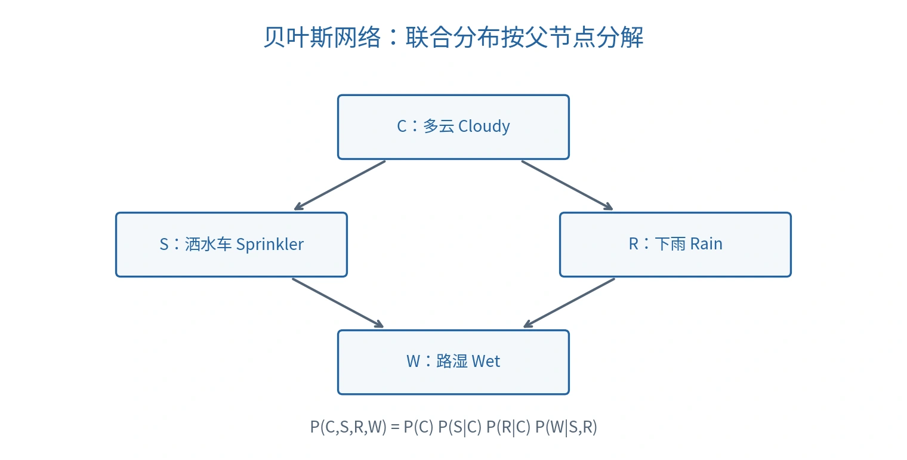

# 概率推理：贝叶斯网络与马尔可夫逻辑

## 从确定规则到不确定知识

经典逻辑讨论事实真／假及必然后果。概率推理（Probabilistic Reasoning）则处理噪声、缺失信息和不确定事件。概率图模型（Probabilistic Graphical Model，PGM）用图表达联合分布的结构，降低表示与计算成本。

这里的节点是随机变量（Random Variable），不是知识图谱中具体的人或地点。图的边通常表达依赖结构；除非另外建立因果模型，不能把概率依赖边自动当作因果箭头。

## 贝叶斯网络

贝叶斯网络（Bayesian Network，BN）由有向无环图（Directed Acyclic Graph，DAG）与各节点的条件概率表（Conditional Probability Table，CPT）组成。联合分布分解为：

$$
P(x_1,\ldots,x_n)=\prod_{i=1}^{n}P(x_i\mid\mathrm{Pa}(X_i)).
$$

无父节点的变量使用边缘概率。局部马尔可夫性质（Local Markov Property）是：**给定一个节点的父节点，该节点与其非后代节点条件独立**。不是“父节点与所有非后代独立”。

### 多云、洒水、下雨与地湿

令 $C$ 为多云（Cloudy）、$S$ 为洒水（Sprinkler）、$R$ 为下雨（Rain）、$W$ 为地面湿（Wet）；1 表示发生，0 表示未发生。

*按课堂四变量模型原创重绘；箭头在本节用于概率分解。*

分解为：

$$
P(C,S,R,W)=P(C)P(S\mid C)P(R\mid C)P(W\mid S,R).
$$

课件概率表如下，未列出的 0 状态概率是同一条件行内的补概率：

| 条件 | 概率 |
| --- | --- |
| 无条件 | $P(C=1)=0.4$ |
| $C=1$ | $P(S=1\mid C=1)=0.1$；$P(R=1\mid C=1)=0.8$ |
| $C=0$ | $P(S=1\mid C=0)=0.5$；$P(R=1\mid C=0)=0.2$ |

| $S$ | $R$ | $P(W=1\mid S,R)$ |
| --- | --- | --- |
| 1 | 1 | 0.99 |
| 1 | 0 | 0.90 |
| 0 | 1 | 0.90 |
| 0 | 0 | 0 |

### 例一：完整事件的联合概率

$$
\begin{aligned}
P(C=1,S=1,R=1,W=1)
&=0.4\times0.1\times0.8\times0.99\\
&=0.03168.
\end{aligned}
$$

若已知 $C=1$，则不再乘 $P(C=1)$：

$$
P(S=1,R=1,W=1\mid C=1)=0.1\times0.8\times0.99=0.0792.
$$

### 例二：未观测变量必须求和

求 $P(W=1\mid C=0,R=1)$，由于没有给定 $S$，需要边缘化（Marginalization）：

$$
\begin{aligned}
P(W=1\mid C=0,R=1)
&=\sum_{s\in\{0,1\}}P(W=1\mid S=s,R=1)P(S=s\mid C=0)\\
&=0.99\times0.5+0.90\times0.5=0.945.
\end{aligned}
$$

这里使用 $S\perp R\mid C$。不能仅取其中一个 $S$ 值，也不能把条件概率当成联合概率直接相乘。

### 条件独立依赖于证据

$S$ 与 $R$ 在给定 $C$ 时独立，但一般不是无条件独立，因为共享父节点 $C$。在 $S\to W\leftarrow R$ 中，$W$ 是碰撞点（Collider）；观测 $W$ 后，$S,R$ 可能出现依赖。这常表现为解释消除（Explaining Away）：已知地湿后，若再获知洒水，地湿对下雨的支持可能减弱。

## 马尔可夫网络

马尔可夫网络／马尔可夫随机场（Markov Network / Markov Random Field）使用无向图，以势函数（Potential Function）表达局部相容性：

$$
P(\mathbf x)=\frac{1}{Z}\prod_k\psi_k(\mathbf x_k),\qquad
Z=\sum_{\mathbf x}\prod_k\psi_k(\mathbf x_k).
$$

势函数非负；$Z$ 是配分函数（Partition Function），使所有配置概率之和为 1。势函数不是条件概率表，不要求每个局部势函数自行归一化。

马尔可夫网络不是描述时间转移的马尔可夫链（Markov Chain）；名称相似不代表语义相同。

## 马尔可夫逻辑网络

马尔可夫逻辑网络（Markov Logic Network，MLN）把一阶逻辑公式与实数权重结合。对有限域展开公式，得到落地公式（Ground Formula），并据此定义概率分布：

$$
P(\mathbf x)=\frac1Z\exp\left(\sum_i w_i n_i(\mathbf x)\right).
$$

$w_i$ 是公式权重，$n_i(\mathbf x)$ 是在世界 $\mathbf x$ 中成立的该公式落地实例数量。命题化的课堂例子每条公式只出现一次，因此 $n_i$ 是 0／1 指示值。[Richardson 与 Domingos 的原始论文](https://www-lrn.cs.umass.edu/lab-lunch/papers/markov-logic-nets.pdf)

正权重表示满足该公式更受偏好；权重不是概率，不必落在 $[0,1]$，也不必总和为 1。有限的大权重仍是软约束（Soft Constraint），不能直接说违规世界概率为零。

### 室内、室外、下雨与灯光秀例题

令 $I$ 为在室内、$O$ 为在室外、$R$ 为下雨、$L$ 为有灯光秀（Light Show）。课堂规则为：

| 公式 | 权重 |
| --- | --- |
| $I\lor O$ | 1 |
| $\neg(I\land O)$ | 9 |
| $R\to I$ | 5 |
| $L\to O$ | 7 |

给定证据 $R=1,L=1$，四个候选世界的满足权重总分是：

| $I$ | $O$ | 满足的权重 | 总分 $s$ | 未归一化质量 |
| --- | --- | --- | --- | --- |
| 0 | 0 | 9 | 9 | $e^9$ |
| 1 | 0 | $1+9+5$ | 15 | $e^{15}$ |
| 0 | 1 | $1+9+7$ | 17 | $e^{17}$ |
| 1 | 1 | $1+5+7$ | 13 | $e^{13}$ |

因此：

$$
P(I=0,O=1\mid R=1,L=1)
=\frac{e^{17}}{e^9+e^{15}+e^{17}+e^{13}}
\approx0.8666.
$$

“只在室外”与“只在室内”的概率比是 $e^{17-15}=e^2$。但事件“在室外”还包含 $(I,O)=(1,1)$，其概率分子是 $e^{17}+e^{13}$，不能用一个世界代替整个查询事件。

若只给定下雨而未观测灯光秀，还要对 $L$ 的两种值求和；不能直接沿用上述条件化表。一般查询是：

$$
P(Q\mid E)=
\frac{\sum_{\mathbf x\models Q\land E}\exp(\sum_i w_i n_i(\mathbf x))}
{\sum_{\mathbf x\models E}\exp(\sum_i w_i n_i(\mathbf x))}.
$$

## 方法比较

| 方法 | 表达内容 | 输出含义 |
| --- | --- | --- |
| 经典逻辑 | 硬规则与真假事实 | 必然成立的逻辑后果 |
| 贝叶斯网络 | 有向依赖与条件概率 | 给定证据的概率 |
| 马尔可夫网络 | 无向相容性与势函数 | 归一化后的世界概率 |
| 马尔可夫逻辑 | 带权逻辑公式 | 综合软规则的概率分布 |

概率推理可以回答“观察到这些证据后，什么更可能发生”，但主动改变一个变量的效果还需要 [因果推理](07-causal-reasoning.md)。

课程来源与公式校订见 [资料对照与校订依据](source-map.md)。
