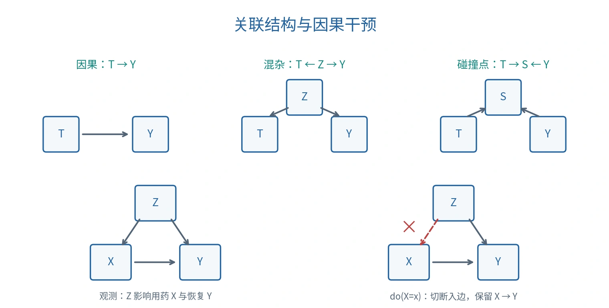
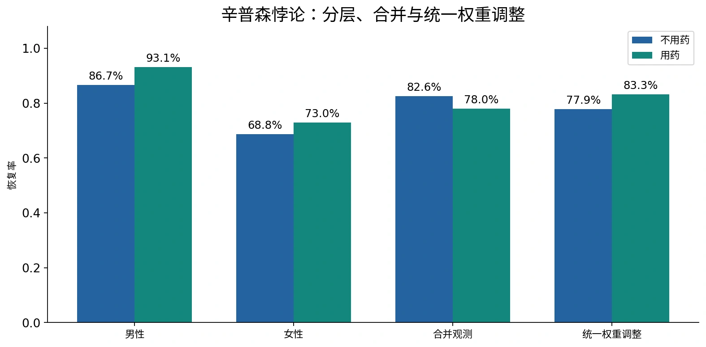

# 因果推理与辛普森悖论

## 关联不等于因果

关联（Association）描述变量共同变化；因果（Causation）关心改变一个变量是否改变另一个变量。条件概率

$$
P(Y\mid X)=\frac{P(X,Y)}{P(X)},\qquad P(X)>0
$$

描述已观察到 $X$ 的人群；其分母是条件事件 $X$ 的概率。它不能自动回答“人为设置 $X$ 后会怎样”。

典型因果结构有三种：

| 结构 | 图 | 含义 |
| --- | --- | --- |
| 直接作用 | $T\to Y$ | $T$ 影响 $Y$ |
| 混杂（Confounding） | $T\leftarrow Z\to Y$ | $Z$ 同时影响处理与结果 |
| 碰撞点（Collider） | $T\to S\leftarrow Y$ | 两者共同影响选择／观测变量 $S$ |

控制混杂变量可能消除伪关联；对碰撞点或其后代条件化却可能打开原本阻断的路径，引入选择偏差（Selection Bias）。因此不能把“控制更多变量”当作自动更正确。

*原创示意图。下方干预只删除进入 $X$ 的箭头，保留 $X$ 对后续变量的影响。*

## 辛普森悖论

辛普森悖论（Simpson's Paradox）指分组中的关联方向与合并后的关联方向不同，甚至完全相反。原因是各组的基础水平和组别权重不同，不能仅靠总体百分比推断原因。

课堂还讨论了 Berkeley 1973 年研究生录取案例：总体录取率中男女差异与分院系比较结果不同。六个主要院系的样本与全校总体范围也不同，不能用“多数院系的方向”机械证明总体公平或不公平。因果解释需要了解申请选择、院系录取率与其他相关机制。[原始录取研究](https://brenocon.com/science_1975_sex_bias_graduate_admissions_data_berkeley.pdf)

### 课堂恢复率数据

令 $X=1$ 表示用药，$Y=1$ 表示恢复，$Z$ 表示性别。下表是课程统计示例：

| 分组 | 未用药：恢复／总数 | 恢复率 | 用药：恢复／总数 | 恢复率 |
| --- | --- | --- | --- | --- |
| 男性 | $234/270$ | 86.67% | $81/87$ | 93.10% |
| 女性 | $55/80$ | 68.75% | $192/263$ | 73.00% |
| 合计 | $289/350$ | 82.57% | $273/350$ | 78.00% |

两组内部都是用药组恢复率更高；合并后却是用药组更低。原因是用药组女性占 $263/350$，未用药组女性仅占 $80/350$，且本例女性组基础恢复率较低。两种处理人群的组成不同。

*根据原始人数计算的原创统计图。分组、合并与调整对应不同统计量。*

## 用共同权重比较

全体样本中男性占 $(270+87)/700=0.51$，女性占 $0.49$。如果因果模型规定 $Z$ 是充分的处理前混杂变量，用同一组别分布加权：

$$
\begin{aligned}
P(Y=1\mid\mathrm{do}(X=1))
&=\frac{81}{87}\times0.51+\frac{192}{263}\times0.49\\
&\approx0.83255,\\
P(Y=1\mid\mathrm{do}(X=0))
&=\frac{234}{270}\times0.51+\frac{55}{80}\times0.49\\
&\approx0.77888.
\end{aligned}
$$

相差约 $0.05367$，即 **5.37 个百分点**。课件把组内率先近似为 $0.93,0.73,0.87,0.69$，所得约为 $0.832$ 与 $0.7818$；这里保留原始分数，避免多次舍入。

这只是给定因果假设后的估计；表本身不能证明所有混杂都已控制。效应大小也不是统计显著性，后者还需要估计不确定性和明确检验。

## 结构因果模型

结构因果模型（Structural Causal Model，SCM）用因果方程描述变量产生机制。例如：

$$
Z=f_Z(U_Z),\quad X=f_X(Z,U_X),\quad Y=f_Y(X,Z,U_Y).
$$

$U$ 是外生变量（Exogenous Variable），表示未在图中展开的背景因素；$X,Y,Z$ 是内生变量（Endogenous Variable）。完全观测的简化 DAG 模型通常还要求适当的外生独立性等假设；若有隐藏共同原因，原图可能不足以识别因果效应。

因果图必须来自机制知识、实验设计或可论证的假设，不能仅凭相关性任意定向。无环图是本课的简化模型；反馈系统可以通过时间索引等方式另行建模。

## 干预：改变机制

干预算子（Intervention Operator）$\mathrm{do}(X=x)$ 表示把 $X$ 的原机制替换为常数 $x$，切断指向 $X$ 的边：

$$
X:=x,\qquad Z=f_Z(U_Z),\qquad Y=f_Y(x,Z,U_Y).
$$

其余生成机制保持原样，并不表示其余变量的实际值都固定不变；$X$ 的后代可能随干预改变。

观测条件化与干预的关键差别在权重：

$$
P(Y\mid X=x)=\sum_z P(Y\mid X=x,Z=z)P(Z=z\mid X=x),
$$

$$
P(Y\mid\mathrm{do}(X=x))=\sum_z P(Y\mid X=x,Z=z)P(Z=z).
$$

第二式是满足调整条件时的后门调整（Back-door Adjustment），不是对任意 $Z$ 都成立的恒等式。这里干预消除了 $Z$ 对 $X$ 的选择作用，但保留 $Z$ 对 $Y$ 的影响。[Pearl 的因果推断综述](https://escholarship.org/content/qt36w8n7pg/qt36w8n7pg.pdf)

### 调整条件

后门调整集合应阻断所有从 $X$ 出发、第一条边指向 $X$ 的非因果路径，且不包含 $X$ 的后代。估计时还依赖一致性（Consistency）、充分的混杂控制以及正值性／重叠（Positivity / Overlap）：相关分层中应有处理与未处理样本。

在完全观测且满足因果假设的 DAG 中，$X$ 的父节点可提供这样的调整集合。不能据此说“控制所有变量”或“控制 $Y$ 的所有父节点”总是正确。调整中介（Mediator）还可能把总效应改成直接效应，改变所问的问题。

## 潜在结果与平均效应

潜在结果（Potential Outcome）$Y(1),Y(0)$ 表示同一单位在处理与未处理下的结果。平均处理效应（Average Treatment Effect，ATE）是：

$$
\mathrm{ATE}=\mathbb E[Y(1)-Y(0)].
$$

同一个单位通常只能观察到其中一种结果，这就是因果推断的根本缺失问题。需要随机实验或可识别的观测模型，才能从实际数据估计未观察到的结果。

二元结果下，平均因果效应（Average Causal Effect，ACE）常写成：

$$
\mathrm{ACE}=P(Y=1\mid\mathrm{do}(X=1))
-P(Y=1\mid\mathrm{do}(X=0)).
$$

它比较两个干预世界；不能直接用未调整的 $P(Y=1\mid X=1)-P(Y=1\mid X=0)$ 代替。

## 反事实推理

反事实（Counterfactual）问：对于已经观察到某结果的同一个对象，如果当时采取另一动作，会怎样？常记为 $P(Y_x\mid E=e)$。

SCM 中通常分三步：

1. 溯因（Abduction）：用实际证据推断该对象的背景因素 $U$。
2. 行动（Action）：把目标机制替换为指定干预。
3. 预测（Prediction）：用同一背景因素重新计算结果。

例如简化模型 $Y=X\lor Z$。观察到 $X=1,Z=0,Y=1$ 时，若改为 $X=0$，同一个对象的 $Y_0=0$；若其背景为 $Z=1$，则 $Y_0=1$。干预效果取决于对象的背景机制。

反事实不是对观察事件取否定，也不能仅由任意联合分布唯一确定；需要更强的结构信息。

## 因果问题的三个层次

| 层次 | 英文 | 典型表达 | 问题 |
| --- | --- | --- | --- |
| 关联 | Association | $P(Y\mid X=x)$ | 观察到 $X$ 的对象怎样？ |
| 干预 | Intervention | $P(Y\mid\mathrm{do}(X=x))$ | 主动设定 $X$ 会怎样？ |
| 反事实 | Counterfactual | $P(Y_x\mid E=e)$ | 这个对象如果当时不同，会怎样？ |

拟合能力首先支持预测；要回答后两类问题，必须进一步明确因果假设、实验或识别条件。

课程来源与公式校订见 [资料对照与校订依据](source-map.md)。
