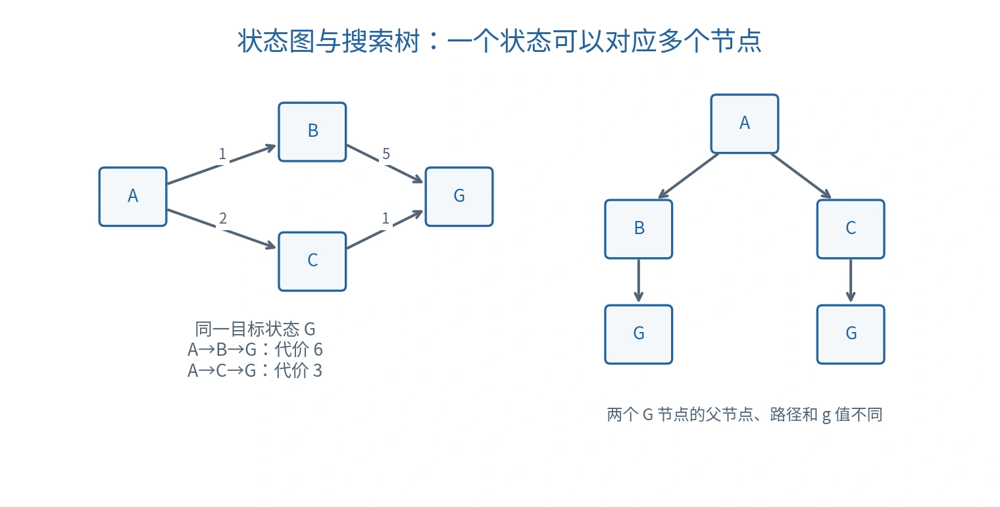

# 搜索问题与通用搜索框架

## 从推理到求解

搜索（Search）是按一定顺序探索候选状态或解的方法。第三节课末尾进入这一主题，介绍问题形式化、搜索树、评价标准和通用框架。这里用最短路径补充解释框架；第四节课已在 [启发式搜索](09-heuristic-search.md)、[对抗搜索](10-adversarial-search.md)与 [MCTS](11-monte-carlo-tree-search.md)中继续展开。

逻辑推理寻找证明，路径规划寻找行动序列，博弈寻找应对策略；它们都可能涉及搜索，但候选对象与成功条件不同。

## 搜索问题的六个组成部分

| 成分 | 英文 | 含义 |
| --- | --- | --- |
| 状态空间 $\mathcal S$ | State Space | 所有可能的状态 |
| 初始状态 $s_0$ | Initial State | 开始位置 |
| 动作 $\mathcal A(s)$ | Actions | 当前状态允许的选择 |
| 转移 $T(s,a)$ | Transition Model | 执行动作后得到的状态 |
| 目标判定 $G(s)$ | Goal Test | 是否满足任务目标 |
| 步代价 $c(s,a,s')$ | Step Cost | 一步动作的成本 |

解是从初始状态到目标的合法动作序列。最优解（Optimal Solution）最小化指定代价，不一定动作数最少：

$$
g(n)=\sum_{i=0}^{k-1}c(s_i,a_i,s_{i+1}).
$$

状态必须保留未来决策所需的信息。导航若有钥匙、油量或时间约束，状态不能只记录当前位置，否则两个实际可行动作不同的场景会被错误合并。

## 状态图与搜索树

状态图（State Graph）中的节点是状态；搜索树（Search Tree）中的节点代表一条到达某状态的路径。同一状态可出现在搜索树的多个位置。

搜索节点通常保存 $(\mathrm{state},\mathrm{parent},\mathrm{action},g)$；父节点与动作用于回溯还原解。



*原创例图：$A\to B\to G$ 代价为 6，$A\to C\to G$ 代价为 3。两个搜索树目标节点对应同一个状态 $G$。*

重复状态（Repeated State）与环（Cycle）会增加计算量。处理重复时要比较路径代价；较晚发现的路径可能更便宜，不能总是“一见过就永远丢弃”。

## 通用搜索框架

边界／前沿（Frontier）保存已生成但未扩展的节点；已到达集合（Reached Set）记录状态及目前已知的路径信息。扩展（Expansion）是生成所选节点的后继。

```text
SEARCH(problem, strategy):
    root ← 节点(problem.initial_state, parent=nil, cost=0)
    frontier ← [root]
    reached ← 初始状态及其路径信息
    while frontier 非空:
        node ← 按 strategy 取出一个节点
        if node 已被更优路径取代:
            continue
        if problem.goal_test(node.state):
            return 从 node 回溯得到的动作序列
        for action in problem.actions(node.state):
            child ← 用转移模型生成后继节点
            if child 是新状态或改善了该状态的路径信息:
                更新 reached
                把 child 加入 frontier
    return failure
```

这是结构框架，strategy 与“改善”的定义需要结合算法确定。空前沿表示探索完可达候选仍无解；资源耗尽则只能报告尚未完成，不能当作证明无解。

对一致代价等算法，通常按 $g$ 记录最便宜的已知路径；使用优先队列时，还需要忽略已过时的队列项。是否重新扩展已处理状态，取决于启发式与算法保证。

## 四个评价维度

| 维度 | 英文 | 含义 |
| --- | --- | --- |
| 完备性 | Completeness | 存在解时，是否保证最终找到解？ |
| 最优性 | Optimality | 是否保证返回代价最小的解？ |
| 时间复杂度 | Time Complexity | 需要生成、检查或扩展多少节点？ |
| 空间复杂度 | Space Complexity | 需要同时保存多少信息？ |

搜索完备性与逻辑证明系统的语义完备性不是同一概念。算法能找到某个解，也不等于会找到最优解。

常用参数为分支因子（Branching Factor）$b$、最浅目标深度 $d$ 与最大深度 $m$。完整生成到深度 $d$ 的树约有

$$
1+b+b^2+\cdots+b^d=O(b^d)\quad(b>1)
$$

个节点，解释了组合爆炸（Combinatorial Explosion）。若采用显式有限状态图，复杂度也可以用状态数与边数表示；不能混用树与图的分析对象。

## 按什么顺序探索

以下对照帮助理解前沿选择策略，不替代完整算法证明。

| 方法 | 英文 | 优先顺序 | 关键限制 |
| --- | --- | --- | --- |
| 广度优先 | Breadth-first Search，BFS | 最浅节点，FIFO 队列 | 等步代价时可得到最短步数解；空间增长快 |
| 深度优先 | Depth-first Search，DFS | 最深节点，栈 | 可能进入无限深分支；通常不保证最优 |
| 一致代价搜索 | Uniform-cost Search，UCS | 已发生代价 $g(n)$ 最小 | 非负代价与适当图搜索条件下保证最优；无限空间还需防止无限低代价探索 |
| 贪心最佳优先 | Greedy Best-first Search | 估计剩余代价 $h(n)$ 最小 | 忽略已发生代价，通常不保证最优 |
| A* | A-star Search | $f(n)=g(n)+h(n)$ 最小 | 最优性依赖启发式、重复处理与终止条件 |

启发函数（Heuristic Function）$h(n)$ 估计到目标的剩余代价。可采纳性（Admissibility）要求 $0\le h(n)\le h^*(n)$；一致性（Consistency）要求每条边满足：

$$
h(n)\le c(n,n')+h(n'),\qquad h(\mathrm{goal})=0.
$$

一致性帮助避免对已扩展状态反复改进。仅有可采纳性时，图搜索可能需要在更便宜路径出现后重新打开节点。A* 通常在目标从前沿被取出时终止；一生成目标就返回，可能错过更便宜路径。[Poole 与 Mackworth 的搜索教材](https://artint.info/3e/html/ArtInt3e.Ch3.S6.html)

### 用小图比较贪心与 A*

上图中取 $h(B)=0,h(C)=1,h(G)=0$。贪心先选 $B$，随后选 $G$，返回代价 6。A* 先选 $B$，生成 $g(G)=6$；但此时 $C$ 的 $f=2+1=3$ 更小，于是扩展 $C$，更新目标代价为 3，最后返回最优路径。

该例说明：估计目标近不近，与整条路径是否便宜，是两个不同问题。

## 对抗搜索与采样搜索的位置

博弈中，后续状态还受对手选择影响。极小极大（Minimax）以对手也会选择对自己最有利的行动为假设；Alpha–Beta 剪枝在已有上下界证明分支不影响最终选择时跳过该分支，在相同深度和评价函数下保留 Minimax 结果。

蒙特卡洛树搜索（Monte Carlo Tree Search，MCTS）利用采样轨迹与统计信息分配探索预算。它不要求遍历整棵树，仍需平衡探索与利用。第三节课在此仅作方向介绍；第四节课的完整算法与例题见后续三篇笔记。

搜索、缓存与启发式的共同目标是减少无效重复和不必要探索；任何优化都需要说明是否保留完备性与最优性。

课程来源与公式校订见 [资料对照与校订依据](source-map.md)。
