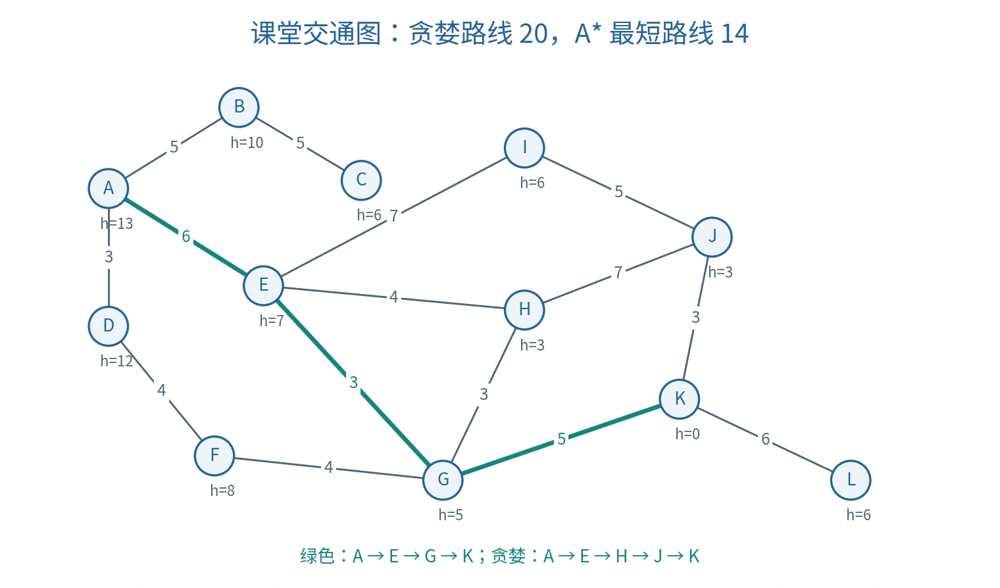

# 启发式搜索：贪婪策略与 A*

本篇整理第四节课的启发式搜索（Heuristic Search），承接 [搜索问题与通用框架](08-search-foundations.md)。核心是：从整个前沿集合选择下一扩展节点，并明确评价函数、重复处理与算法保证之间的关系。

## 前沿选择与路径代价

前沿／边缘集合（Frontier）保存已生成、尚未扩展的节点。搜索并不是每次在当前节点的邻居中选一个“继续走”；扩展当前节点后，下一次可以取出前沿中早已存在的另一个分支。

| 符号 | 英文 | 含义 |
| --- | --- | --- |
| $g(n)$ | Path Cost | 从起点沿当前节点对应路径到 $n$ 的实际累计代价 |
| $h(n)$ | Heuristic Function | 从 $n$ 到目标的估计剩余代价 |
| $h^*(n)$ | Optimal Remaining Cost | 从 $n$ 到目标的真实最小代价，通常未知 |
| $f(n)$ | Evaluation Function | 决定前沿节点扩展优先级的评价值 |

$g(n)$ 是一条已经生成的路径的代价，不自动是到该状态的全局最短代价。不同节点可以对应同一状态，但 $g$ 和父节点不同。

无信息搜索（Uninformed Search）主要依据问题本身的状态、动作和代价；有信息搜索（Informed Search）还使用启发知识。若代价是道路距离，直线距离常是下界；若代价是行驶时间，应使用“直线距离／最大速度”等同单位的下界，不能直接把距离与时间相加。

## 课堂交通网络的完整例题

图中的道路按双向边解释，起点为 $A$，目标为 $K$。边权是本例使用的数值代价，图形布局不表示实际比例。



*按课件图 3.1 和表 3.2 原创重绘。绿色标出代价 14 的最短路线。*

| 道路 | 代价 | 道路 | 代价 | 道路 | 代价 |
| --- | --- | --- | --- | --- | --- |
| A—B | 5 | B—C | 5 | A—D | 3 |
| A—E | 6 | D—F | 4 | E—I | 7 |
| I—J | 5 | E—H | 4 | H—J | 7 |
| J—K | 3 | E—G | 3 | H—G | 3 |
| F—G | 4 | G—K | 5 | K—L | 6 |

| 状态 | A | B | C | D | E | F | G | H | I | J | K | L |
| --- | --- | --- | --- | --- | --- | --- | --- | --- | --- | --- | --- | --- |
| $h$ | 13 | 10 | 6 | 12 | 7 | 8 | 5 | 3 | 6 | 3 | 0 | 6 |

### 贪婪最佳优先搜索

贪婪最佳优先搜索（Greedy Best-first Search）使用：

$$
f(n)=h(n).
$$

依照课件顺序，排除路径回路：

| 取出节点 | 新候选或关键比较 | 下一选择 |
| --- | --- | --- |
| A | B:10、D:12、E:7 | E |
| E | H:3、G:5、I:6，前沿仍有 B、D | H |
| H | J:3、经 H 到达的 G:5 | J |
| J | K:0 等候选 | K |

得到 $A\to E\to H\to J\to K$，代价为：

$$
6+4+7+3=20.
$$

而 $A\to E\to G\to K$ 的代价只有 $6+3+5=14$。贪婪搜索在 $H$ 之后看到 $h(J)=3<h(G)=5$，却忽略到 $J$ 已付出的 $g(J)=17$。因此，即使 $h$ 本身是合理下界，仅按 $h$ 排序也不保证整体最优。

### A*：综合已付出与剩余代价

A* 搜索（A-star Search）使用：

$$
f(n)=g(n)+h(n).
$$

下表保留不同路径的树节点，直接显示课件关键比较；图搜索可丢弃没有改善 $g$ 的重复状态。

| 取出／扩展 | 新候选的 $g+h=f$ | 处理后的关键前沿 |
| --- | --- | --- |
| A | B:$5+10=15$；D:$3+12=15$；E:$6+7=13$ | E:13、B:15、D:15 |
| E | H:$10+3=13$；G:$9+5=14$；I:$13+6=19$ | H:13、G:14、B:15、D:15、I:19 |
| H | 经 H 的 G:$13+5=18$；J:$17+3=20$ | 经 E 的 G:14 仍最优先 |
| G（经 E） | K:$14+0=14$；F:$13+8=21$；经 G 的 H:$12+3=15$ | K:14 优先 |
| K | 取出时通过目标测试 | 回溯 A—E—G—K |

下一扩展节点从 $H$ 切换到旧前沿中的 $G$，而不是继续走向 $H$ 的孩子 $J$。这不是改变已经走过的真实旅程，而是在算法维护的候选路径中切换探索对象。

## 可采纳性／可容性

可采纳启发式（Admissible Heuristic，课件称“可容”）不高估最小剩余代价：

$$
0\le h(n)\le h^*(n),\qquad h(\mathrm{goal})=0.
$$

它保证 $f(n)$ 不超过“沿当前前缀，再用最优后缀到目标”的总成本；并不是要求 $f(n)$ 总小于全局最优成本，因为当前前缀本身可能绕路。

$h=0$ 是最保守的可采纳启发式，A* 此时退化为一致代价搜索（Uniform-cost Search）。下界越接近真实剩余成本，通常越有利于减少扩展；但启发值的计算本身也有成本。

## 一致性及两个推论

一致启发式（Consistent Heuristic）对每条转移满足：

$$
h(n)\le c(n,a,n')+h(n'),\qquad h(\mathrm{goal})=0.
$$

### 一致性推出可采纳性

沿从 $n_0$ 到目标 $n_k$ 的最优路径连续使用不等式：

$$
\begin{aligned}
h(n_0)&\le c_0+h(n_1)\\
&\le c_0+c_1+h(n_2)\\
&\le\cdots\le\sum_{i=0}^{k-1}c_i+h(n_k)=h^*(n_0).
\end{aligned}
$$

不能反向推出一致性。补充反例：$S\to A$ 代价 1、$A\to G$ 代价 2，取 $h(S)=3,h(A)=0,h(G)=0$。各节点都不高估真实剩余代价，但 $h(S)=3>1+h(A)=1$，违反一致性。

### 路径上的 $f$ 不下降

$$
\begin{aligned}
f(n')&=g(n)+c(n,a,n')+h(n')\\
&\ge g(n)+h(n)=f(n).
\end{aligned}
$$

这里的 $n'$ 是由 $n$ 扩展出的路径节点。它为图搜索的关闭状态策略提供了依据。

## A* 的完备性与最优性

### 完备性条件

对于无限展开的树，一个常用充分条件是：每个节点后继有限；单步代价有统一正下界 $\epsilon>0$；启发值有有限下界。若存在有限代价目标，这些条件使给定 $f$ 上界内只有有限深度、有限数量候选，不会被无限低代价路径阻塞。

有限状态图在正确去重等条件下可以有更弱的要求。正下界是上述一般树搜索保证的条件，不能误说所有含零代价边的有限图都不能运行 A*。

### 最优性证明的核心

设最优解代价为 $C^*$，它尚未被完整找到时，最优路径上至少存在一个待扩展节点 $n$。在可采纳性与正确保留路径的条件下：

$$
f(n)=g^*(n)+h(n)\le C^*.
$$

若算法先取出一个更昂贵的目标 $G'$，则 $f(G')=g(G')>C^*$，与“取前沿最小 $f$”矛盾。因此目标在**从前沿取出**时返回可保证最优；在生成目标时立即返回可能失败。

图搜索还必须处理被合并的路径：一致性允许已扩展状态永久关闭；仅可采纳但不一致时，发现更小 $g$ 必须允许重新打开（Reopen）。[搜索教材中的条件说明](https://artint.info/3e/html/ArtInt3e.Ch3.S6.html)

### 可重新打开的图搜索伪代码

```text
A_STAR(start, goal_test, successors, h):
    best_g[start] ← 0
    frontier ← 优先队列，插入节点(start, g=0, f=h(start))
    while frontier 非空:
        n ← 弹出最小 f 节点
        if n.g > best_g[n.state]:
            continue                  # 更好的路径已取代此队列项
        if goal_test(n.state):
            return 按父节点回溯的路径
        for (action, next_state, cost) in successors(n.state):
            new_g ← n.g + cost
            if next_state 不在 best_g 或 new_g < best_g[next_state]:
                best_g[next_state] ← new_g
                插入新节点，保存 n 为父节点，f=new_g+h(next_state)
    return failure
```

该版本不使用永久关闭集合，因此保留更好路径重新扩展的机会。优先队列需要明确同值时的稳定排序方法，但并列顺序不改变满足条件时的最优代价。

## 复杂度与适用范围

| 方法 | 完备性 | 最优性 | 常见最坏资源规模 |
| --- | --- | --- | --- |
| 贪婪最佳优先 | 有限状态空间且正确去重时可保证；无限空间不普遍保证 | 一般不保证 | 有限深树时间、空间均可达 $O(b^m)$ |
| A* | 依赖有限分支、代价下界等条件 | 依赖可采纳性及正确重复处理 | 最坏仍可能指数增长，保存前沿常成为瓶颈 |

$b$ 为分支因子，$m$ 为最大深度；若 $m$ 无穷，不能把 $O(b^m)$ 当作有限资源上界。显式图实现还可按顶点、边和堆操作分析。

A* 不必访问所有状态；它扩展的是前沿中有竞争力的候选。启发式可以减少搜索量，但不会消除所有问题的组合爆炸。

## 自检

为什么 A* 扩展完 $H$ 后选择的是经 $E$ 到达的 $G$？为什么 $5+10$ 应始终是 15？为什么发现更便宜的同状态路径要更新？为什么一致性可以推出可采纳性，而反方向不成立？

下一主题：[Minimax 与 Alpha–Beta](10-adversarial-search.md)。

课程资料与校订说明见 [资料对照](source-map.md)。
