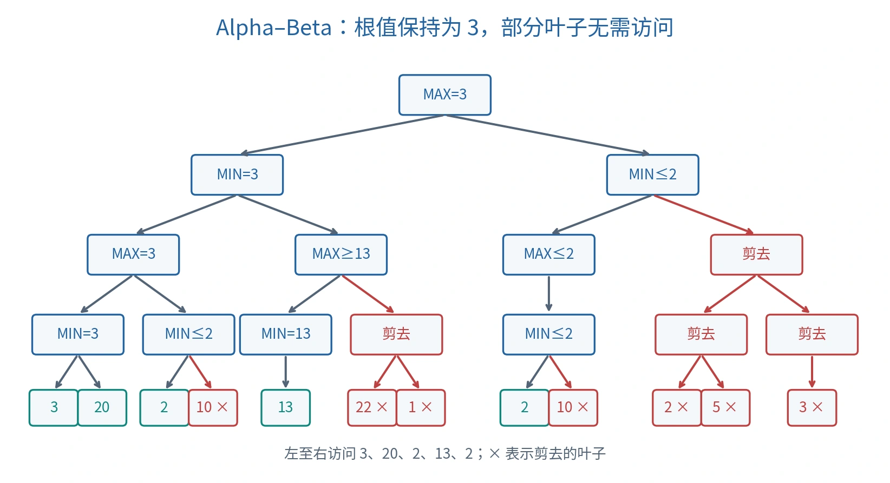

# 对抗搜索：Minimax 与 Alpha–Beta 剪枝

## 从路径最短到对手响应

对抗搜索（Adversarial Search）／博弈搜索（Game Search）考虑结果受多个参与者行动影响的场景。本课使用二人轮流行动、确定性、完全信息的竞争模型。统一以 Max 玩家收益计分：Max 选择较大值，Min 选择较小值。

零和博弈（Zero-sum Game）两方收益之和为 0；常和博弈（Constant-sum Game）之和为固定常数。经平移等转换可以按统一视角比较，但不能把任意多人或非零和场景都套入二人 Minimax。

## 游戏的形式化要素

| 函数／对象 | 含义 |
| --- | --- |
| $s=(\mathrm{board},\mathrm{player})$ | 棋盘局面与轮到谁行动 |
| $\mathrm{Actions}(s)$ | 当前方所有合法动作 |
| $\mathrm{Result}(s,a)$ | 动作后的局面与下一行动方 |
| $\mathrm{Terminal}(s)$ | 是否已经结束 |
| $U(s)$ | 终局收益，统一使用 Max 视角 |

状态不只是一幅棋盘；同一棋盘轮到不同方走，其可选动作与价值可以不同。终局 Utility 作用于状态，不是直接作用于尚未执行的动作。

## Minimax 递归

极小极大／最小最大搜索（Minimax）从终局自底向上求值：

$$
V(s)=\begin{cases}
U(s),&\mathrm{Terminal}(s),\\
\max_{a\in\mathrm{Actions}(s)}V(\mathrm{Result}(s,a)),&\mathrm{Player}(s)=\mathrm{Max},\\
\min_{a\in\mathrm{Actions}(s)}V(\mathrm{Result}(s,a)),&\mathrm{Player}(s)=\mathrm{Min}.
\end{cases}
$$

根节点 Max 选择使后继 $V$ 最大的动作。它考虑对手的最佳响应，而不是期望对手故意给自己机会。

### 课堂三分支例题

三个 Min 分支的叶值分别为 $(3,9,10)$、$(2,5,7)$、$(10,5,1)$。Min 返回 $3,2,1$，根 Max 返回：

$$
\max\{\min(3,9,10),\min(2,5,7),\min(10,5,1)\}=3.
$$

若中间分支后两个值尚未知，记作 $x,y$，则 $\min(2,x,y)\le2$。根已经能取得 3，所以中间分支不会成为更优选择。这就是剪枝的基础。

## Alpha 与 Beta 表示什么

Alpha–Beta 剪枝（Alpha–Beta Pruning）为递归搜索传递上下界：

- $\alpha$：沿当前搜索上下文，Max 在已检查选择中能够保证的下界。
- $\beta$：沿当前搜索上下文，Min 在已检查选择中能够保证的上界。

这些界来自祖先及已访问兄弟分支，不是每个节点从一开始就已知的精确值。根初始化 $(-\infty,+\infty)$，子节点继承父节点的窗口（Window）。

Max 节点每得到一个孩子值就更新 $\alpha\leftarrow\max(\alpha,v)$；Min 节点更新 $\beta\leftarrow\min(\beta,v)$。当

$$
\alpha\ge\beta
$$

时，剩余孩子无法改善祖先决策，可以停止该分支。等号也可以剪；课件只写严格大于，是较弱的充分条件。

### 两种截断

| 当前节点 | 已取得的界 | 为什么剩余孩子无用 |
| --- | --- | --- |
| Min | $v\le\alpha$ | Min 最终值至多是 $v$；上层 Max 已有至少 $\alpha$ 的替代项 |
| Max | $v\ge\beta$ | Max 最终值至少是 $v$；上层 Min 已有至多 $\beta$ 的替代项 |

截断时返回的值可能只是该子树的界，而非精确 Minimax 值；根的最终值仍可正确。若记录截断子树到缓存，应区分上界、下界和精确值，不能一律当作精确结果复用。

## 完整课堂树：值与访问顺序



*从左向右深度优先访问，红色 × 表示不求值的叶子；带不等号的内部值表示已知界。*

不剪枝时，自底向上：

1. 七个底层 Min 节点返回 $3,2,13,1,2,2,3$。
2. 四个 Max 节点返回 $3,13,2,3$。
3. 两个 Min 节点返回 $3,2$。
4. 根 Max 返回 $\max(3,2)=3$。

按图中顺序剪枝：

| 已访问叶子 | 形成的约束 | 可省略的叶子 |
| --- | --- | --- |
| 3、20 | 左侧第一个 Min 返回 3，下方同级 Max 的 $\alpha=3$ | — |
| 2 | 下一 Min 已有 $\beta=2\le\alpha=3$ | 其第二个叶子 10 |
| 13 | 左侧上层 Min 已有 $\beta=3$，下一 Max 已达 13 | 其另一个 Min 子树的 22、1 |
| 2 | 根已有 $\alpha=3$；右侧分支中的 Min 已得 2 | 紧随其后的 10 |
| 回传界 2 | 右侧上层 Min 已达 $\beta=2\le\alpha=3$ | 最后 Max 子树的 2、5、3 |

总共只求值 5 个叶子：$3,20,2,13,2$；完整树有 12 个叶子。返回根值仍是 3。

## 可直接对应程序的伪代码

```text
ALPHA_BETA(s, depth, alpha, beta):
    if Terminal(s):
        return Utility(s)             # Max 视角
    if depth == 0:
        return Evaluate(s)            # 同一视角的截断估值
    if Player(s) == Max:
        value ← -infinity
        for a in OrderedActions(s):
            value ← max(value, ALPHA_BETA(Result(s,a), depth-1, alpha, beta))
            alpha ← max(alpha, value)
            if alpha >= beta:
                break
    else:
        value ← +infinity
        for a in OrderedActions(s):
            value ← min(value, ALPHA_BETA(Result(s,a), depth-1, alpha, beta))
            beta ← min(beta, value)
            if alpha >= beta:
                break
    return value
```

根调用时使用完整窗口。选择动作时在根记录当前最佳孩子及其动作。不能在每次递归时把传入的界重新置为无穷；也不能在 Min 层更新 Alpha、Max 层更新 Beta 而颠倒语义。

平局动作的具体选择取决于遍历顺序；剪枝保持最优值，但不保证枚举出所有并列最优动作。

## 复杂度、顺序与搜索深度

Minimax 对有限深度 $m$、分支因子最多 $b$ 的树进行深度优先搜索，时间 $O(b^m)$；若每层缓存待访问孩子，空间 $O(bm)$，若惰性生成后继则递归栈可为 $O(m)$，均未计额外的跨节点缓存。

Alpha–Beta 最坏仍是 $O(b^m)$；在理想动作排序的典型均匀树分析中可降到 $O(b^{m/2})$。访问顺序越早暴露强界，剪枝越多；它不改变相同树、相同截断深度和同一评价函数下的 Minimax 值。

对极大或无限展开空间，剪枝本身不保证搜索终止。实际程序用深度限制、时间预算与局面评价（Evaluation）控制工作量；仍可以对有限深度树使用 Alpha–Beta。

地平线效应（Horizon Effect）指关键后果出现在搜索深度之外，截断估值因此偏差。它是受限前瞻的风险，不能用一个对局故事单独证明某次失败的具体原因。增加深度、改进估值或对关键局面延伸搜索可缓解，不能保证彻底消除。

## 自检

为什么根能取得 3 后，中间 Min 分支的首个值 2 已足够剪枝？为什么深度截断后的“最优”只是相对当前评价树的最优？为什么返回的子树界不能直接当成缓存中的精确值？

下一主题：[UCB 与 MCTS](11-monte-carlo-tree-search.md)。

课程资料与校订说明见 [资料对照](source-map.md)。
