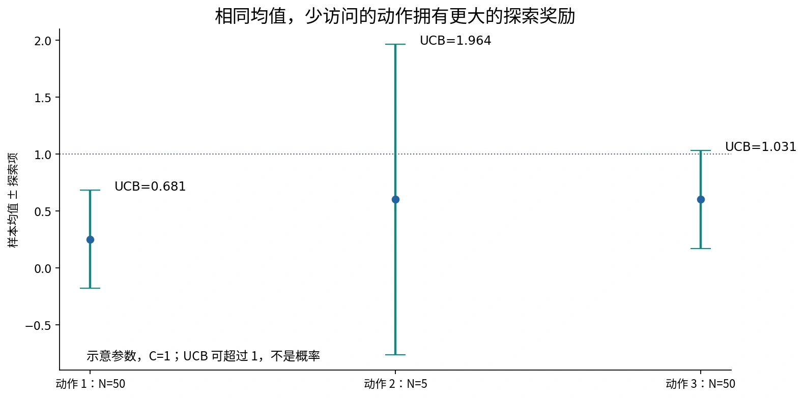
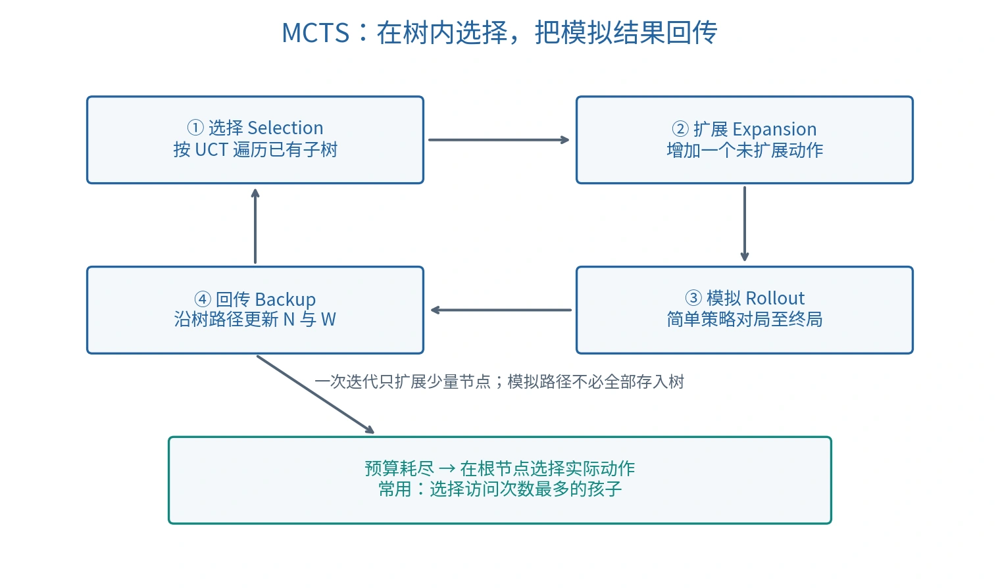

# 蒙特卡洛树搜索：从 UCB 到 UCT

## 为什么用采样估值

搜索树过大时，完整枚举与剪枝仍可能超出预算。蒙特卡洛树搜索（Monte Carlo Tree Search，MCTS）反复模拟可能的未来，用经验收益指导后续探索。在有限预算下，它提供统计估计和动作选择，不是每次都给出最优性证明。

理解 MCTS 需要先理解探索与利用（Exploration–Exploitation）：既要集中计算目前看起来有价值的动作，也要给尚未充分试验的动作机会。

## 多臂老虎机

多臂老虎机／多臂赌博机（Multi-armed Bandit，MAB）有 $K$ 个动作。动作 $i$ 的奖励来自未知分布 $D_i$，均值为 $\mu_i$；经典随机老虎机模型假设每个动作的奖励序列独立同分布、分布不随时间变化，且奖励有界，常缩放到 $[0,1]$。

第 $t$ 次选动作 $I_t$，得到奖励 $r_t$。算法根据过去结果选择下一动作，希望在 $T$ 次内最大化期望累计奖励。它不需要记住一个有真实转移作用的物理状态；关键是所维护的历史统计，不能把普通老虎机强行解释成有复杂状态转移的任务。

设 $\mu^*=\max_i\mu_i$。课件中的悔值／遗憾（Regret）为：

$$
\rho_T=T\mu^*-\sum_{t=1}^{T}r_t.
$$

这里的基准是每次选**期望收益最高的同一个动作**，不是事先知道每步所有随机结果的“神谕”。某次随机收益很高时，$\rho_T$ 可以为负；理论通常评价其期望：

$$
\mathbb E[\rho_T]
=\sum_{i=1}^{K}(\mu^*-\mu_i)\,\mathbb E[N_i(T)].
$$

$N_i(T)$ 是到 $T$ 时动作 $i$ 被选择的次数。算法不知道 $\mu_i$，但分析可以用它评价策略。

## 从纯贪心到 epsilon 贪心

根据动作 $i$ 的累计奖励 $W_i$ 与访问次数 $N_i$，样本均值为 $\bar X_i=W_i/N_i$。纯贪心（Pure Greedy）总选当前均值最大的动作。早期噪声可能使真正好的动作估值偏低，之后又因不再被采样而无法纠正。

课堂五臂例子设置：

$$
(\mu_1,\ldots,\mu_5)=(0.3,0.4,0.5,0.6,0.7).
$$

每臂为支撑区间长度 0.4 的均匀分布，方差为 $0.4^2/12=1/75$。一次 10000 次试验中，纯贪心主要访问 4 号而错过均值更大的 5 号。这是某次随机试验的现象，不是每次都一定选择 4 号。

$\epsilon$-贪心（Epsilon-greedy）以 $1-\epsilon$ 的概率选当前最好动作，以 $\epsilon$ 的概率随机选动作。它保证有探索机会，但均匀随机探索没有根据各动作的访问次数和价值调整分配。固定正 $\epsilon$ 还会一直尝试次优动作；其长期遗憾保证与递减 $\epsilon$ 策略不同。

未采样动作没有均值。实现时可以先各采样一次，或赋予未访问动作最高优先级；不能把 $0/0$ 计算成普通均值。

## UCB1：乐观地选择置信上界

置信上界（Upper Confidence Bound，UCB）综合经验均值和不确定性。本课统一用 $T$ 表示此前累计选择次数，$N_i$ 表示此前动作 $i$ 的访问次数：

$$
\mathrm{UCB}_i=\bar X_i+C\sqrt{\frac{2\ln T}{N_i}},\qquad N_i>0.
$$

选取 $I=\operatorname*{arg\,max}_i\mathrm{UCB}_i$。标准 UCB1 的这一写法取 $C=1$；课堂引入 $C$ 作为探索系数（Exploration Coefficient）。其他文献把 $\sqrt2$ 吸收到系数里，比较参数前要统一公式。

- 利用项 $\bar X_i$：已有证据显示的平均收益。
- 探索项：访问少时大，访问增多时下降；若某臂长期不被访问，随总次数增大它又可能获得更高优先级。
- $C$ 越大，越愿意投入不确定动作；$C=0$ 退化为纯贪心。



*原创数值示意：$T=105,C=1$，三动作均值为 $0.25,0.6,0.6$，访问次数为 $50,5,50$。动作 2 优先；这些不是课件原实验观测值。*

UCB 值可超过 1，即使奖励在 $[0,1]$。它是乐观选择指标，不是获胜概率，也不能把探索项叫作必然获得的额外收益。普通 UCB1 的探索项不使用样本方差；方差自适应算法属于其他变体。

## 从 Hoeffding 不等式恢复根号

霍夫丁不等式（Hoeffding's Inequality）对固定的 $s$ 个独立 $[0,1]$ 样本的均值给出：

$$
P(\mu_i-\bar X_{i,s}>\delta)\le\exp(-2s\delta^2),\qquad\delta>0.
$$

令右侧为 $T^{-4}$，两边取自然对数：

$$
-2s\delta^2=-4\ln T
\quad\Longrightarrow\quad
\delta=\sqrt{\frac{2\ln T}{s}}.
$$

因此在较小的失败概率下，$\mu_i$ 不超过 $\bar X_{i,s}+\delta$。这解释了 UCB1 的探索项，不能漏掉平方根，也不能把分母与分子倒置。

严格的自适应策略分析还需处理随机访问次数和多个时刻的误差事件，不能仅凭一次固定样本不等式就宣称整个搜索树的全部估值同时可靠。

### 遗憾界的范围

对经典有界、平稳、独立奖励模型，标准 UCB1 的期望遗憾有问题相关的对数界，常概括为：

$$
\mathbb E[\rho_T]=O\!\left(\sum_{i:\Delta_i>0}\frac{\ln T}{\Delta_i}\right),\qquad
\Delta_i=\mu^*-\mu_i.
$$

用 $\Delta_{\min}>0$ 可粗略写为 $O(K\ln T/\Delta_{\min})$，忽略常数和低阶项。这个保证不能原封不动套给任意 $C$、变化分布或博弈树里的奖励。原论文也介绍了 UCB2，故“UCB2 不存在”并不正确。[Auer、Cesa-Bianchi 与 Fischer 原始论文](https://aima.cs.berkeley.edu/~russell/classes/cs294/s11/readings/Auer%2Bal%3A2002.pdf)

## UCT：将 UCB 思想用于树

UCT（UCB applied to Trees，课堂称上限置信区间树搜索）在每个节点用类似 UCB 的指标选择子节点，是 MCTS 的一种树策略（Tree Policy），不是 MCTS 的唯一形式。

每个树节点 $v$ 通常保存状态、行动方、父节点、孩子、未扩展动作，以及：

$$
N(v)=\text{访问次数},\qquad W(v)=\text{累计奖励},\qquad Q(v)=\frac{W(v)}{N(v)}.
$$

选择孩子 $u$ 的指标为：

$$
\mathrm{UCT}(v,u)=Q(u)+C\sqrt{\frac{2\ln N(v)}{N(u)}}.
$$

未访问孩子优先试验或令指标为 $+\infty$；已有访问的父节点才计算对数。奖励的计分视角需让当前行动方确实选择对自己有利的动作。

树中的采样策略会不断变化，所遇到的收益不严格等同于固定老虎机的独立同分布样本；UCT 理论需要额外分析，不能只引用 UCB1 的遗憾界就证明所有 MCTS 的有限预算最优性。[UCT 原始论文](https://sites.ualberta.ca/~szepesva/papers/ecml06.pdf)

## MCTS 的四个步骤



*原创流程图。模拟路径不要求全部永久加入搜索树。*

| 步骤 | 英文 | 做什么 |
| --- | --- | --- |
| 选择 | Selection | 从根沿已有树按 UCT 选孩子，直到终局或存在未扩展动作的节点 |
| 扩展 | Expansion | 若非终局，选一个未扩展动作，创建其后继节点 |
| 模拟 | Simulation / Rollout | 从新节点用简单策略继续到终局，求奖励 |
| 回传 | Backpropagation / Backup | 沿此次树路径更新 $N,W$ |

选择使用树统计；模拟使用默认策略（Default Policy），可以随机或带简单启发式。模拟到终局不意味着把每个模拟位置都保存为树节点。这里的回传是更新计数与收益，不是神经网络梯度反向传播。

### 课堂一次迭代的数字

课件图 3.21 中，根访问次数为 2，两个孩子分别记录 $10/1$、$5/1$，按 $C=1$ 计算：

$$
10+\sqrt{2\ln2}\approx11.18,\qquad
5+\sqrt{2\ln2}\approx6.18.
$$

选择左孩子 $L$，扩展新节点 $C$，初始统计为 $0/0$。模拟取得 Max 视角的收益 3。课件按“节点保存父行动方收益”的约定，更新：

| 节点 | 更新前 $W/N$ | 更新后 $W/N$ |
| --- | --- | --- |
| C（父节点为 Min） | $0/0$ | $-3/1$ |
| L（父节点为 Max） | $10/1$ | $13/2$ |
| 根（示意采用相反视角） | $-15/2$ | $-18/3$ |

该例用收益 3、5、10 展示计数与正负号，不满足前面 $[0,1]$ 奖励下的标准 UCB1 假设。实际使用应统一奖励尺度与探索系数。层级本身不决定所有节点分数的正负；获胜方与收益定义才决定符号。

## 对抗中的奖励视角

### 方案一：统一保存根玩家奖励

令胜、平、负奖励为 $1,0.5,0$。所有节点都累计根玩家的奖励 $r$，回传时统一 $N\leftarrow N+1,W\leftarrow W+r$。选择时：

$$
\mathrm{Score}(v,u)=
\begin{cases}
Q(u)+\mathrm{Bonus}(v,u),&\text{轮到根玩家},\\
1-Q(u)+\mathrm{Bonus}(v,u),&\text{轮到对手}.
\end{cases}
$$

对手追求根玩家失败，因而最大化 $1-Q$。探索项仍取正；不能把整个 UCT 指标取负，使对手也避开不确定动作。

### 方案二：按父行动方保存奖励

每个孩子保存执行该动作的玩家收益，父节点始终最大化孩子的 $Q+\mathrm{Bonus}$。若奖励是 $[0,1]$ 胜率编码，转换视角用 $1-r$；若是 $+1,0,-1$ 对称编码，转换用 $-r$。

两种方案都可行，但选择和回传必须使用同一约定。有跳过回合（Pass）时，还必须看实际玩家身份，不能机械按树深奇偶翻转符号。

## 统一根视角的算法框架

```text
MCTS(root, budget):
    while 预算仍允许开始一次迭代:
        v ← root
        path ← [root]
        while v 非终局 且 v 的动作已全部扩展:
            v ← 按当前行动方视角的 UCT 选择孩子
            path.append(v)
        if v 非终局:
            a ← 从 v 的未扩展动作选一个
            v ← 创建执行 a 后的独立状态节点
            path.append(v)
        r ← 从 v 模拟至终局，按根玩家编码收益
        if 模拟因时间预算中断:
            结束搜索，不回传伪造终局收益
        for node in path:
            node.N ← node.N + 1
            node.W ← node.W + r
    return 根节点中访问次数最多孩子的动作
```

若预算太短未完成有效迭代，应保留合法动作作为后备选择。若使用截断估值代替终局收益，应另行明确估值尺度与意义，而不是把中断模拟当成平局。

## 搜索期间的探索与最终落子

树内 UCT 分配计算预算，故意尝试某些不确定动作。预算结束后不必再次按含探索奖励的 UCT 落子；常用规则是选根孩子访问次数最大者，也可按均值选，须明确约定和未充分采样风险。

MCTS 常用作随时可停止的算法（Anytime Algorithm）：有合法后备动作时，可在预算内持续改进估计。更多模拟通常提供更多证据，但单次结果不保证随迭代数严格单调提高。

A* 引导低成本路径，Alpha–Beta 保留 Minimax 值地剪枝，MCTS 则统计估计有希望的动作。神经网络可以提供动作先验或局面估值，强化学习可改进这些模型；MCTS 本身不要求神经网络或预先训练数据。

## 自检

为什么未访问孩子不能算 $W/N$？为什么模拟路径不必全部存入树？为什么用胜 1、平 0.5、负 0 时不能简单每层取负？为什么最终落子可以按访问次数而不是 UCT 选择？

实现示例：[黑白棋中的 MCTS](12-reversi-mcts.md)。

课程资料与校订说明见 [资料对照](source-map.md)。
