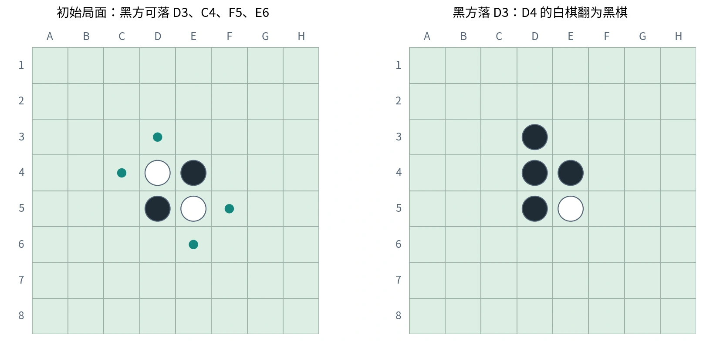

# 黑白棋中的 MCTS：状态、规则与实现

本篇从第四节课的黑白棋演示提取算法与实现知识。重点是把 [MCTS](11-monte-carlo-tree-search.md) 的四步骤映射到合法的游戏状态与接口，不涉及作业提交流程。

## 游戏规则也是状态转移规则

黑白棋／翻转棋（Reversi / Othello）使用 $8\times8$ 棋盘，黑方先行，双方轮流行动。通常初始中央四枚棋子为两黑两白。合法落子必须满足：

1. 目标格为空。
2. 从该格出发，八个方向中至少一个方向存在连续的一枚或多枚对方棋子。
3. 该段对方棋子的另一端紧接己方棋子，中间没有空格。
4. 所有被新棋夹住的对方棋子都翻转，不能自行选择只翻某一方向。

八个方向是横、竖与斜线的两个方向，程序可用 $(\Delta r,\Delta c)\in\{-1,0,1\}^2\setminus\{(0,0)\}$ 扫描。



*原创规则图。列 A—H、行 1—8；绿点是合法动作。黑方下 D3 后，D4 被翻转。*

本图初始合法动作是 D3、C4、F5、E6，和课堂演示相符；代码内行列索引从 0 还是 1 开始，必须以实际接口为准。

## Pass 与终局必须区分

当前玩家没有合法动作时必须跳过（Pass），让对手行动；有合法动作时不能任意跳过。棋盘填满，或者双方均没有合法动作时，游戏才结束。终局通常按棋子数量比较胜负。

$$
\mathrm{Terminal}(s)=\mathrm{Full}(s)\lor
\bigl(\mathcal A_{\mathrm{black}}(s)=\varnothing\land
\mathcal A_{\mathrm{white}}(s)=\varnothing\bigr).
$$

“一方无棋可下”不是游戏结束，也不是该方已经输掉。对搜索层可把 Pass 作为显式动作，生成棋盘相同、行动方改变的状态。之后对手落子，再重新判断轮到谁以及是否还有动作。

棋盘与行动方必须一起构成状态：

$$
s=(\mathrm{board},\mathrm{player\_to\_move}).
$$

若省略行动方，同一棋盘的 Pass 前后会被错误合并。奖励视角也应根据真正玩家身份判断，不能靠“这已经是第几层”猜测。

## 课堂代码框架的职责

| 对象／方法 | 英文或接口名 | 职责 |
| --- | --- | --- |
| 棋盘对象 | Board | 保存棋子，计算与执行合法转移 |
| 合法动作 | `get_legal_actions` | 给定颜色，返回合法位置；演示中使用 `list(...)` 物化结果 |
| 落子 | `move` | 放置棋子、翻转被夹棋子、更新棋盘，返回翻转坐标 |
| 坐标转换 | Coordinate Conversion | 在棋盘标签与数字坐标间转换 |
| 随机玩家 | RandomPlayer | 从合法动作中随机选择 |
| 人类玩家 | HumanPlayer | 读取并验证输入坐标 |
| 对局控制 | Game | 交替调用玩家、处理终局与显示 |
| AI 决策 | AIPlayer / `get_move` | 接受局面并返回选择的动作 |

资料未包含配套平台源码，不能根据转写确定参数顺序、返回容器、Pass 标记或准确文件名。课堂展示的 X／O 表示黑／白，`.` 表示空格；大小写和坐标格式以实际类定义为准。

随机玩家是理解调用流程的基线（Baseline），不是已经实现 MCTS 的 AI。算法新增的节点类与辅助函数应与棋盘规则、决策接口各自职责分开。

## MCTS 节点应保存什么

| 字段 | 目的 |
| --- | --- |
| 独立状态与行动方 | 确定下一次合法动作和收益视角 |
| 父节点与入边动作 | 回传并把根孩子还原为实际落子 |
| 孩子列表 | 选择已扩展分支 |
| 未扩展动作 | 防止重复增加同一个孩子，支持扩展阶段 |
| $N,W$ | 访问次数与累计奖励 |

终局没有待探索动作；非终局但无普通落子时，待扩展动作包含 Pass。不能把这两种状态都建成“无孩子的失败节点”。

## 将四步骤落实到黑白棋

### 选择与扩展

在已完全扩展且非终局节点，按 UCT 选择孩子；遇到未扩展动作就选一个生成后继。生成状态时必须复制棋盘或使用可靠的落子—撤销机制（Make / Unmake）。

若直接在所有孩子间共享同一可变棋盘，扩展一条分支会改变另一条分支与真实对局，造成合法动作、回传奖励都错误。仅复制外层对象而仍共享二维行数组，也不能实现独立状态。

### 模拟

默认策略可在每个非终局状态中随机选合法落子，执行后切换行动方。没有动作时执行 Pass；双方都无动作才结束。模拟棋盘不必全部保存为树节点。

```text
ROLLOUT(state, root_player, deadline):
    s ← 独立复制 state
    while s 非终局:
        if 已到 deadline:
            return interrupted
        actions ← 当前玩家的合法动作
        if actions 为空:
            切换玩家                  # 非终局意味着对手仍有动作
            continue
        a ← 从 actions 随机选择
        执行 a 并翻转所有被夹棋子
        切换玩家
    return 从 root_player 视角编码的终局胜负
```

若棋盘落子不可撤销，复制是更直接的实现；若用撤销优化，必须同时恢复落子格、全部翻转格及相关状态。

### 回传

若统一根玩家视角，胜、平、负采用 $r=1,0.5,0$：

$$
N(v)\leftarrow N(v)+1,\qquad W(v)\leftarrow W(v)+r.
$$

在对手节点选孩子时使用 $1-Q$ 的利用项。终局棋子差（Disc Difference）也可以作为收益，但尺度不同，会改变探索系数所代表的强度，不能与胜率编码混用。

一轮迭代的模拟可能跨过多个未加入树的局面；通常只对选择与扩展经过的存储节点回传，而非凭空为全部模拟位置创建统计项。

## 时间预算与返回动作

运行时间受可选动作数量、每次模拟长度、棋盘复制和合法动作计算成本影响。固定迭代次数不能在所有局面保证相同耗时。

实现应使用单调时钟（Monotonic Clock）判断截止点，在选择和模拟内部检查预算，并为最终检查与返回预留余量。若用 Python，可通过 `time.monotonic()` 记录时间，不应依赖系统日期是否被调整。

决策入口先取得真实局面的合法动作：只有一个动作可直接返回；没有合法动作则按接口的 Pass 约定处理；正常情况下先保留一个合法后备动作，再开始搜索。最后返回已探索根孩子的动作，并再次确认合法性。

截断模拟如果没有明确估值，不应按平局计入统计；可以丢弃该次未完成样本。若引入启发式估值，则需说明它并非真实终局结果。

## 有意义的实现验证

| 场景 | 应观察到的行为 |
| --- | --- |
| 初始局面 | 合法动作及坐标与图中一致 |
| 多方向夹子 | 所有方向都翻转，无空格跨越 |
| 当前方无动作、对手有动作 | Pass 后继续，不提前终止 |
| 双方无动作但棋盘未满 | 正确判定终局 |
| 仅一个合法动作 | 返回唯一合法动作 |
| 搜索前后比较真实棋盘 | 搜索不改变输入局面 |
| 对手可立即获利的分支 | 选择策略反映对手利益，不把对手当合作方 |
| 不同阶段与先后手 | 检查时间、合法性与收益视角的一致性 |

单盘结果具有随机性；评价策略应使用多盘及不同先后手，而不能凭一次胜负认定算法强弱。整次测试等待很久时，先区分单步耗时、对局步数与对局盘数；某一步接近预算，乘以许多步和许多盘会放大总时间。

## 方法扩展

可以改进模拟策略、动作排序、终局估值、棋盘复制或树的复用。角点控制、行动力（Mobility）等可作为启发式，但短期吃子最多不代表终局最优；是否改善效果需要独立对局验证。

这些改进不能破坏合法性、Pass 处理与收益视角。先有正确的游戏转移和四步骤，再优化采样效率，才能解释表现变化来自哪里。

课程资料与校订说明见 [资料对照](source-map.md)。
