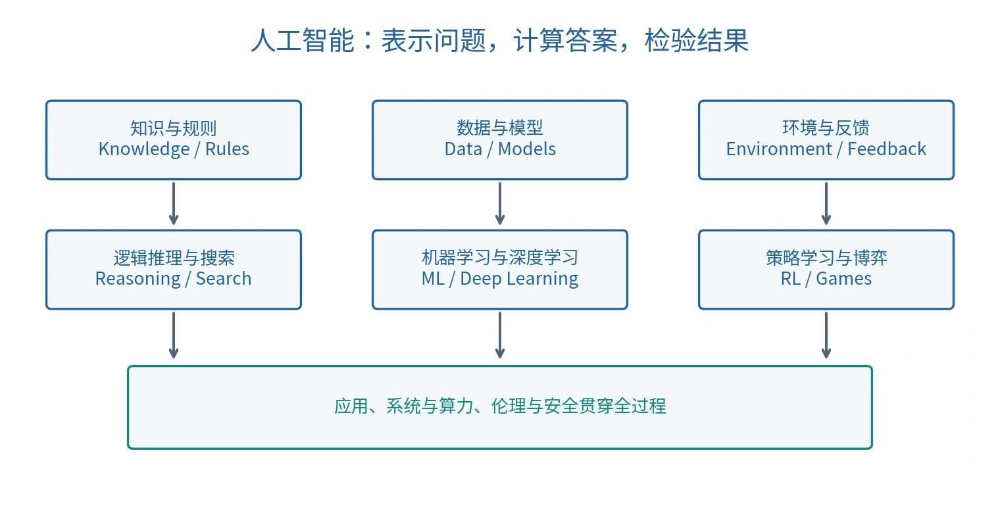

# 人工智能引论

人工智能引论（Introduction to Artificial Intelligence）研究如何表示知识、进行推理、寻找解，并从数据和环境反馈中学习。本组笔记覆盖前三节课，按知识依赖组织；原课件与课堂截图中的公式、例题已并入对应主题。

## 阅读路线

| 顺序 | 主题 | 核心问题 |
| --- | --- | --- |
| 1 | [人工智能的框架与发展](01-ai-overview.md) | 智能任务有哪些计算方法？ |
| 2 | [可计算性与形式系统](02-computability.md) | 什么能算，什么不能算？ |
| 3 | [命题逻辑与归结](03-propositional-logic.md) | 怎样从前提严格推出结论？ |
| 4 | [一阶逻辑与量词推理](04-first-order-logic.md) | 怎样表达对象、关系与一般规律？ |
| 5 | [知识图谱、FOIL 与路径推理](05-knowledge-graph-reasoning.md) | 怎样学习规则、补全关系？ |
| 6 | [概率推理：贝叶斯网络与马尔可夫逻辑](06-probabilistic-reasoning.md) | 不确定的知识怎样参与推理？ |
| 7 | [因果推理与辛普森悖论](07-causal-reasoning.md) | 观察到的关系与主动改变的效果有什么区别？ |
| 8 | [搜索问题与通用搜索框架](08-search-foundations.md) | 怎样把求解转化为状态空间探索？ |

建议先理解逻辑中的“必然推出”，再阅读知识图谱中的“学习得到”，最后比较概率预测与因果结论。搜索主题承接第三节课末尾；具体搜索算法只列出理解框架所需的对照。

*原创概念图。可编辑源图与复现方法见 [图示说明](assets/README.md)。*

## 三节课的知识覆盖

| 课堂 | 整理范围 | 对应笔记 |
| --- | --- | --- |
| 第一节 | AI 的提出、研究传统、发展阶段、方法体系、计算基础、应用与素养 | 1、2 |
| 第二节 | 命题与联结词、等价变形、归结；绪论补充；谓词、量词与推理 | 1—4 |
| 第三节 | 逻辑回顾、归纳逻辑编程、FOIL、PRA、概率图模型、因果推断、搜索入门 | 3—8 |

## 复习入口

- [概念与公式速查](quick-reference.md)：符号、适用条件与易混概念。
- [资料对照与校订依据](source-map.md)：原始资料覆盖范围和关键订正。

知识图谱、贝叶斯网络、因果图和搜索图都使用“图”，但节点、边与计算目标不同；阅读时先确认图的语义，避免把一种图上的结论搬到另一种图上。

课程来源与公式校订见 [资料对照与校订依据](source-map.md)。
